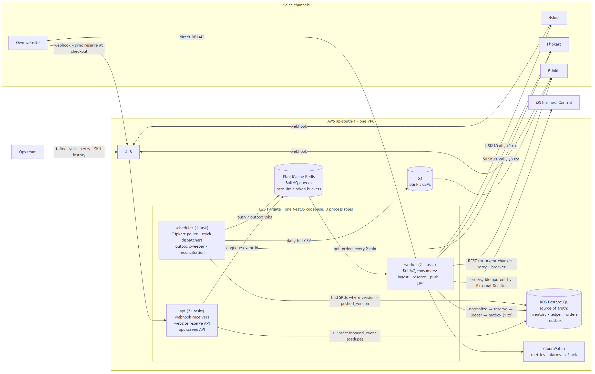
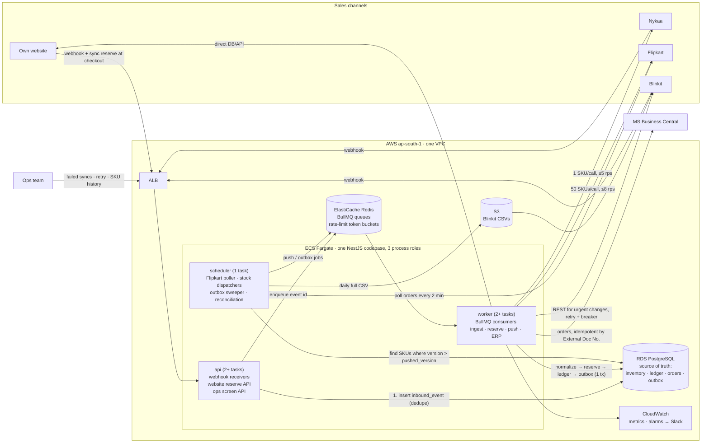

# Order & Inventory Sync Service: Design

## 1. The core idea

- **PostgreSQL is the only source of truth for stock.** Every stock change is one conditional `UPDATE` plus one append-only ledger row, in a single transaction. Redis never decides stock.
- **Channels are mirrors.** A pusher compares "what we last pushed" with "what the channel should show now" and sends absolute quantities, so a failed push fixes itself on the next cycle.
- **Marketplaces see a buffered quantity**, sized to how late we learn about their sales. The last few units of a SKU sell on the website, which reserves at checkout and can't oversell. This is what actually stops overselling; correct reservation only decides *who* gets cancelled.
- **All outbound work goes through a durable outbox in Postgres** (ERP orders, channel cancels). An outage delays the work but never loses it.

## 2. Architecture

Mermaid source

| Role | Runs on | Does |
|---|---|---|
| `api` | Fargate behind ALB, autoscaled on CPU | Verifies webhook signatures, stores the raw event, enqueues it, returns 200 in <50 ms. Serves the website's `POST /reservations` and the ops screen. |
| `worker` | Fargate, autoscaled on queue depth | Normalizes and reserves, pushes stock, sends ERP orders and channel cancels. One BullMQ queue per channel plus one for ERP, so a stuck channel can't block the others. |
| `scheduler` | 1 Fargate task, Redis leader lock | Flipkart polling, stock dispatch ticks every 5 s, outbox sweeper, nightly BC reconciliation, Blinkit CSV. |

**Sizing.** The sale peak is 300 orders/min ≈ 5 orders/s ≈ 10 stock-row updates/s, which is tiny for Postgres. The baseline fleet (2 api + 2 worker) covers 10× peak; autoscaling is insurance, so no manual scale-up is needed.

**Cost (≈ ₹/month).** Fargate 9.5k, RDS db.t4g.medium Multi-AZ 12k, ElastiCache t4g.small + replica 4k, ALB 2k, NAT 3.5k, CloudWatch/S3/Secrets 3k. **Total ≈ ₹34k**, under the ₹50k budget. No Kafka, no Datadog.

## 3. Data model (PostgreSQL)

| Table | Key columns | Constraints / purpose |
|---|---|---|
| `inventory` | `sku` PK, `on_hand`, `reserved`, `version` | `CHECK (reserved >= 0 AND reserved <= on_hand)` is the last line of defence against overselling. `version` increments on every change. |
| `stock_ledger` | `sku`, `delta_on_hand`, `delta_reserved`, `on_hand_after`, `reserved_after`, `reason`, `ref_type`, `ref_id`, `actor`, `created_at` | Append-only. `reason` ∈ RESERVE, RELEASE_CANCEL, DISPATCH, RETURN_RESTOCK, GRN, MANUAL_ADJUST, RECONCILE. Index `(sku, created_at)` answers "why did stock change, and when?" |
| `inbound_events` | `channel`, `dedupe_key`, `event_type`, `payload jsonb`, `status`, `error` | `UNIQUE (channel, dedupe_key)` drops duplicate deliveries before any work. |
| `orders` | `id` uuid, `channel`, `external_order_id`, `status`, `payment_mode`, `total_amount`, `hold_expires_at` | **`UNIQUE (channel, external_order_id)` is the main guard against duplicate orders.** |
| `order_items` | `(order_id, sku)` PK, `qty`, `unit_price`, `reserved` bool | `reserved` makes cancelling safe to run twice. |
| `sync_jobs` (outbox) | `type` (ERP_CREATE, ERP_CANCEL, CHANNEL_CANCEL), `ref_id`, `status`, `attempts`, `next_attempt_at`, `last_error`, `depends_on`, `idempotency_key` UNIQUE | Written in the same transaction as the business change. Feeds the ops screen. |
| `channel_stock` | `(channel, sku)` PK, `channel_sku_id`, `pushed_version`, `last_published_qty`, `last_push_error` | `inventory.version > pushed_version` is the "dirty" list. |
| `channel_cursors` | `channel` PK, `cursor_ts` | Where the Flipkart poller resumes. |

**Order states:** `HELD` (website checkout only) → `RESERVED` → `ERP_SYNCED` → `DISPATCHED`; `CANCELLED` and `REJECTED_OOS` are terminal. Transitions only move forward, so an older event can never undo a newer one.

## 4. Order ingestion

1. **Webhooks (website, Nykaa, Blinkit).** Verify HMAC, `INSERT … ON CONFLICT (channel, dedupe_key) DO NOTHING`, enqueue the event id, return 200. `dedupe_key` is the channel's event id, or `hash(external_order_id, event_type, payload)` if there is none. No business logic on the request path, so a burst can't time out webhooks.
2. **Polling (Flipkart).** Every 2 min, fetch orders updated since `cursor_ts − 5 min`. The overlap never skips a late-indexed order, and the unique key makes re-reads harmless. The cursor moves only after the page is stored.
3. **Out-of-order events (Nykaa).** Events for one order are serialized by `SELECT … FOR UPDATE` on its `orders` row. A `CANCELLED` that arrives first creates a `CANCELLED` tombstone with no reservation; the later `CREATED` sees a terminal state and does nothing. A repeated `CREATED` is a no-op.
4. **A channel that is down.** Per-channel queues keep the others running. A reconciliation job every 15 min lists recent orders from each channel and feeds them through the same idempotent path, catching missed webhooks.
5. **Lost Redis jobs.** Redis carries work; Postgres stores it. The sweeper re-enqueues any `inbound_events`/`sync_jobs` row stuck for more than 60 s.

## 5. Inventory consistency: the last unit, sold twice in the same second

**Reserve** = `UPDATE inventory SET reserved = reserved + :q, version = version + 1 WHERE sku = :s AND on_hand - reserved >= :q RETURNING …`. A multi-line order reserves all lines in one transaction, in sorted SKU order (no deadlocks); one failed line rolls back the whole order. See [reservation-pseudocode.md](reservation-pseudocode.md).

`MRS-LIP-104` has `on_hand 40, reserved 39`: 1 unit left. A Nykaa and a Flipkart order for it are processed by two workers at the same moment.

1. Both events are already stored and deduplicated. Worker A (Nykaa) and B (Flipkart) each open a transaction.
2. A's `UPDATE` takes the row lock; 40 − 39 ≥ 1 holds, so `reserved` → 40, `version` → 9001.
3. B's `UPDATE` **blocks on A's lock**. It does not read a stale value.
4. A writes the `RESERVE` ledger row, sets the order `RESERVED`, inserts `sync_jobs(ERP_CREATE)`, commits.
5. B wakes. Under READ COMMITTED, Postgres **re-checks the `WHERE` against the committed row**: 40 − 40 ≥ 1 is false, 0 rows updated. B rolls back; nothing partial remains.
6. In a second transaction B marks its order `REJECTED_OOS`, inserts `sync_jobs(CHANNEL_CANCEL)` and increments the oversell metric.
7. The next dispatcher tick (≤5 s) sees `version 9001 > pushed_version` and pushes **0** to every channel.

**Who wins:** whoever locks the row first. We ignore `event_time`: channel clocks disagree and Flipkart orders arrive up to 2 min late, so arrival order is the only deterministic rule. The `CHECK` constraint catches any code bug that bypasses the `WHERE`.

**Why this race should rarely reach a marketplace.** Marketplaces see `max(0, available − B)`, where B = ⌈Σ_c velocity_c × lag_c⌉ (each channel's 15-min sales rate for the SKU × how late we see its sales: ≈2.5 min Flipkart, ≈60 s others; ops can set a sale-day minimum). The **website shows full `available`** and reserves at checkout (`HELD`, 15-min expiry), so the last B units sell there, and a shopper who loses the race sees "sold out" *before paying*.

## 6. Stock push within 60 s

The push is **state-based, not event-based**. Each tick, a channel's dispatcher selects SKUs where `inventory.version > channel_stock.pushed_version`, computes the absolute quantity, skips unchanged values, and pushes the rest. Five sales of a hero SKU in one tick become one call. A failed call leaves `pushed_version` behind, so the next tick retries with the *current* value. One dispatcher per channel means an older value can never overwrite a newer one.

| Channel | Mechanism | Capacity vs. sale-day need |
|---|---|---|
| Website | Direct write, event-driven | Instant |
| Nykaa | 1 SKU/call, Redis token bucket at 4.5 rps | ≈270 SKUs/min. If more change in a minute, **most urgent first**: SKUs going to 0, then below the low-stock threshold, then by % change. 480 → 478 can wait a minute; 3 → 0 can't. |
| Flipkart | Batches of 50 SKUs on each 5 s tick, bucket at 8 rps (2 rps left for polling) | 400 SKUs/s: all 1,200 SKUs fit in 24 calls (3 s). On 429, pause for `Retry-After` and lower the rate. |
| Blinkit | REST for every change during the day; full CSV snapshot overnight | Absolute quantities make retries after timeouts safe. The CSV corrects any drift. |

## 7. Failure handling

- **Retries.** Retryable errors (timeouts, 5xx, 429) get exponential backoff with jitter (1 s → 10 min). Non-retryable ones (4xx, unknown SKU) go straight to `DEAD`, as does any job after 10 retryable failures. Both alert and appear on the ops screen.
- **ERP exactly once.** `ERP_CREATE` is written in the same transaction as the reservation, so a confirmed order without an ERP job can't exist. Delivery is at-least-once, made idempotent: the BC sales order's *External Document No.* = our `order.id`, and we look it up before each POST. A crash after BC accepted the order finds it on retry and marks the job `DONE`. `ERP_CANCEL` `depends_on` the create job, so it can't overtake it.
- **ERP Sunday downtime.** The maintenance window is configured and the ERP queue is paused during it; outside it, a circuit breaker opens after 5 consecutive failures and probes every 2 min. Paused time doesn't count toward the attempt limit. Reservations and pushes continue; only ERP waits. The backlog (≈700 orders) drains oldest-first at a capped rate.
- **Blinkit timeouts (2%).** A timeout is "outcome unknown"; resending an absolute value is safe. The breaker opens above 20% failures per minute. If Blinkit is unreachable for 10+ min, ops get the list of low-stock SKUs to zero manually in the portal.
- **Messages that keep failing → ops screen.** Lists `FAILED/DEAD` jobs and `channel_stock` rows not pushed for 5+ min, with last error and payload. **Retry** (single or bulk) resets a job to `PENDING`, which is safe because every handler is idempotent. It also shows each SKU's ledger timeline.

## 8. Observability (day one, CloudWatch → Slack)

1. **Oversell rate:** `REJECTED_OOS / orders`, rolling 15 min. Alert above 0.3% (headroom under the 0.5% target).
2. **Stock-push lag** per channel: p95 of ledger change → successful push. Alert above 60 s for 5 min.
3. **Oldest pending job age** per queue. Alert if ERP > 30 min outside the maintenance window, or any channel > 2 min.
4. **Dead-letter count:** alert as soon as it is above 0.
5. **Ingestion freshness** per channel: time since the last order (or successful Flipkart poll) vs. the normal rate for that hour. Catches a channel that silently stopped sending webhooks.

## 9. Deliberately out of v1

| Left out | Why |
|---|---|
| Partial fulfilment / split orders | All-or-nothing is simpler and safe; rejected multi-SKU orders are rare. |
| Order edits (qty/address) | Not in the brief's events; handled manually. |
| Restock on return initiation | Stock goes back on sale only after warehouse QC (recorded in BC or the ops screen). Restocking earlier would itself cause overselling. |
| ML buffers, pricing sync, bundles | Velocity × lag is enough for 0.5%; tune after the first sale. |
| Full ops admin (roles, order editing) | v1 is the failed-sync screen plus SKU history. 3 devs, 6 weeks. |
| Kafka, per-channel services, multi-region | 5 orders/s doesn't need them; per-channel queues give the isolation. |

## 10. Trade-offs

| Decision | Chose | Rejected | Why |
|---|---|---|---|
| Where stock is reserved | Postgres conditional `UPDATE` + ledger in one tx | Redis Lua counters; Redlock | One source of truth; ledger and outbox are atomic with the reservation; 10 updates/s is easy for Postgres. Redis counters need a second store kept in sync, and a failover can lose acknowledged reservations. |
| Job transport | BullMQ on Redis, Postgres outbox/inbox as the store | SQS; Kafka | Redis is already in the stack; BullMQ gives delays, retries and rate limiting. Durability comes from Postgres + sweeper, so losing Redis only delays work. Kafka is too much to run for 3 people. |
| How stock is pushed | Coalesced **absolute** quantities via version comparison | Forwarding each change as a delta | Absolute values are safe to resend (Blinkit timeouts, 429s), and coalescing fits Nykaa's 5 rps. Lost deltas cause drift that never heals. |
| What marketplaces see | `available − B`; the website keeps the last units | Same number everywhere | A few units unsold for a few minutes, in exchange for far fewer marketplace cancellations. |
| Service shape | Modular monolith, 3 process roles | Microservice per channel | 3 devs, 6 weeks. Isolation comes from per-channel queues, not separate deployments. |

## 11. Assumptions

1. All channels and BC offer a *list recent orders* API (reconciliation) and channels a *cancel order* API (`REJECTED_OOS`).
2. Webhooks are HMAC-signed with a shared secret, and channels retry failed deliveries for a while.
3. Orders arrive confirmed (website COD counts as confirmed when placed). Only successfully reserved orders go to the ERP.
4. BC is the warehouse system of record. We poll it every 5 min for dispatches (lower `on_hand` and `reserved`) and GRNs (raise `on_hand`); a nightly job compares `on_hand` with BC and writes `RECONCILE` rows.
5. BC supports lookup by External Document No. and has its own throttle (we drain at ≤5 rps).
6. Blinkit accepts the CSV via upload API or SFTP; if portal-only, we generate it and ops uploads it.
7. SKU codes map 1:1 to channel listing IDs; no bundles.
8. Channel quantities are integers ≥ 0, and 0 does not delist a product.
9. The ops screen sits behind company SSO/VPN; fine-grained roles come later.

## 12. Stretch A: a second warehouse in Bengaluru

- `inventory` is keyed by `(sku, warehouse_id)`; the ledger, `order_items` and BC sales orders (Location Code) carry `warehouse_id`.
- **Routing:** nearest warehouse with stock by pincode, else the other, tried in one transaction with locks in fixed `(warehouse, sku)` order. One order ships from one warehouse.
- **Publishing:** channels with seller locations get per-warehouse stock; others get the sum.
- **New work:** transfers (TRANSFER_OUT/IN ledger reasons), a pincode→warehouse table, reconciliation per BC location. The concurrency model is unchanged; the locked row is just more specific.

## 13. AI usage

Used Claude (Claude Code) to help write and refine the document and pseudo-code, and to check edge cases. I can explain and defend every decision.
